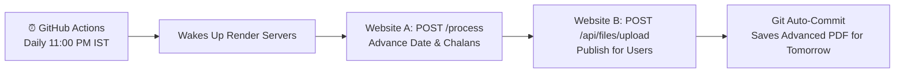

# PDF Transfer Bridge — Automated Daily Workflow (11:00 PM IST)

Automated cloud bridge connecting **Website A (PDF Generator)** to **Website B (PDF Distribution & Sharing)** once daily using **GitHub Actions**.

- **Website A (Generator)**: `https://pdf-editorx.onrender.com`
- **Website B (Receiver)**: `https://pdf-sender-iaa4.onrender.com`
- **Automation Runner**: GitHub Actions (100% Free, No server or database required)
- **Schedule**: Every day at **11:00 PM IST** (`17:30 UTC`)

---

## How It Works



1. Every day at 11:00 PM IST, GitHub Actions automatically starts the workflow.
2. It reads `template/active_template.pdf`.
3. It ensures Website A and Website B are awake, then sends the PDF to Website A to generate the new shifted date and chalan numbers.
4. It downloads the generated PDF (`All_X.pdf`) and uploads it to Website B under `foradvance685@gmail.com`.
5. It overwrites `template/active_template.pdf` and commits it back to the repository so the next day's run advances from today's output.

---

## How to Push to GitHub

1. Create a new repository on [GitHub](https://github.com/new) (e.g. `pdf-transfer-hub`).
2. Run the following commands in this directory:

```bash
git init
git add .
git commit -m "Initial commit: Daily PDF Transfer Hub with GitHub Actions"
git branch -M main
git remote add origin https://github.com/YOUR_USERNAME/pdf-transfer-hub.git
git push -u origin main
```

---

## How to Test Manually in GitHub

1. Go to your repository on GitHub.
2. Click on the **Actions** tab at the top.
3. Select **Daily PDF Transfer Bridge (11:00 PM IST)** in the left sidebar.
4. Click **Run workflow** -> **Run workflow**.
5. Within 15–20 seconds, the workflow will complete, upload to Website B, and commit the updated template.

---

## Optional: GitHub Secrets (If Credentials Change)

If you ever change your credentials or endpoints, add them under **Settings -> Secrets and variables -> Actions**:

| Secret Name | Default Value | Description |
| :--- | :--- | :--- |
| `WEBSITE_A_URL` | `https://pdf-editorx.onrender.com` | Website A Base URL |
| `WEBSITE_B_URL` | `https://pdf-sender-iaa4.onrender.com` | Website B Base URL |
| `WEBSITE_B_EMAIL` | `foradvance685@gmail.com` | Uploader account email |
| `WEBSITE_B_PASSWORD` | `admin123` | Uploader account password |
